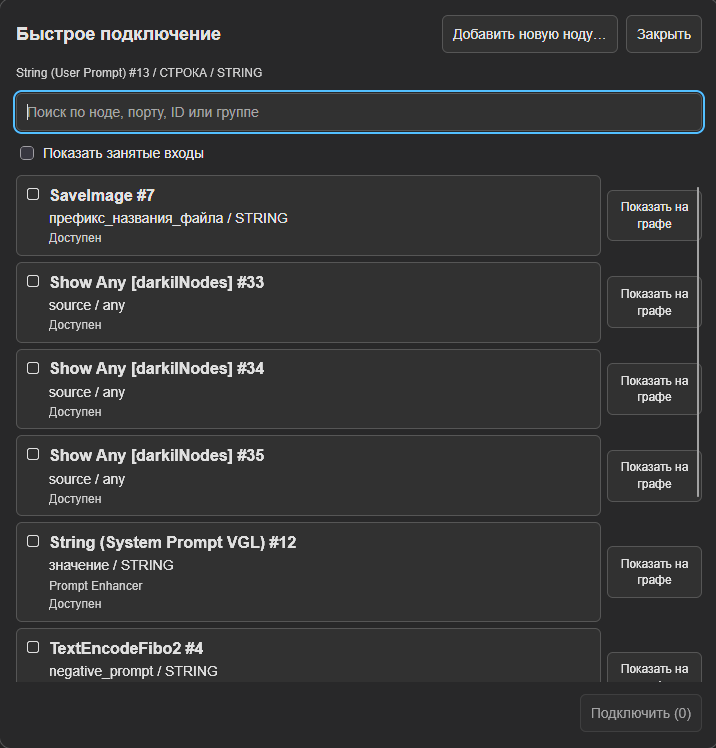
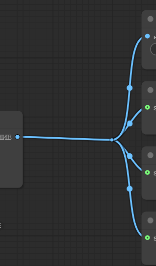
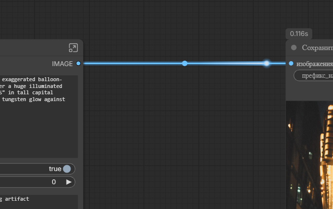
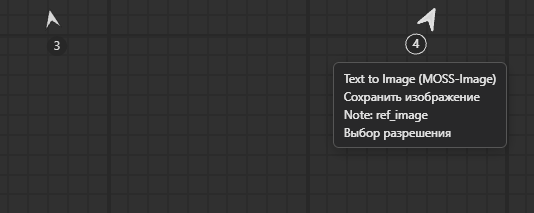
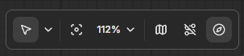
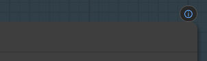
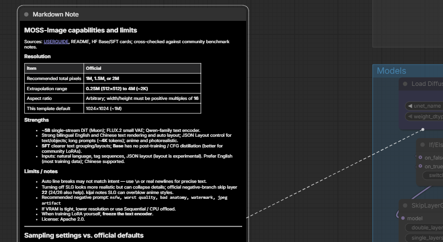
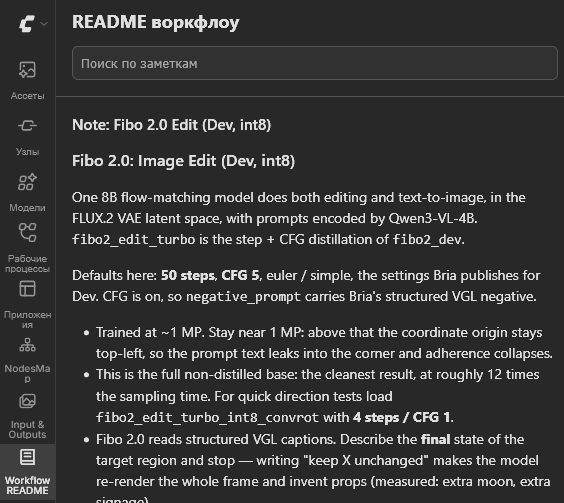
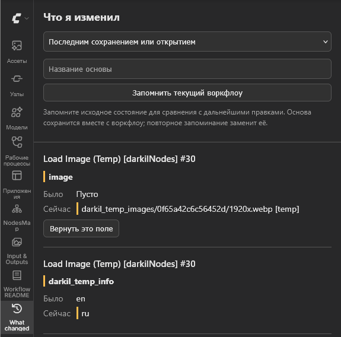

# Breeze для ComfyUI

Расширения интерфейса, с которыми граф ComfyUI проще читать и в нём проще
работать. Они отвечают на вопросы, которые граф вызывает, пока на него
смотришь: что входит в эту ноду, что идёт по этому проводу, что приходит на
этот вход, куда делись ноды, если экран пуст, что за нода, когда холст
отдалён так, что её уже не прочесть, к какой ноде относится заметка, что
следующий запуск посчитает заново, что запуск считает сейчас.

[English](README.md) | [История изменений](CHANGELOG_RU.md)

<p align="center">
  <a href="LICENSE"></a>
  
</p>

![Граф ComfyUI на русском, выделен KSampler. Выборка модели AuraFlow и два Кодирования текста CLIP, которые в него входят, обведены синим с мягким синим свечением; Декодировать VAE, в который он выходит, -- янтарным. Указатель задержался на проводе МОДЕЛЬ, идущем в KSampler: на проводе две фиолетовые стрелки, одна назад, к Выборке модели AuraFlow, другая вперёд, к KSampler, а подсказка гласит MODEL, Выборка модели AuraFlow #69 МОДЕЛЬ, → KSampler #70 модель. Справа синие провода ИЗОБРАЖЕНИЕ из Декодировать VAE идут одним стволом до маленькой точки и там расходятся](docs/preview.png)

*Выделен KSampler: то, что в него входит, обведено синим, то, что из него
выходит, янтарным. Указатель задержался на проводе: подсказка называет его
концы, а две стрелки переносят к ним вид. Справа провода одного выхода идут
общим стволом.*

## Что умеет

- **Соединить ноды без путешествия по графу.** Отпустите провод на пустом
  месте и найдите совместимый порт существующей ноды по названию, ID, порту
  или группе. Отметьте один или несколько входов и нажмите «Подключить».
  Если тянуть из входа, выбирается один источник. «Показать на графе»
  переносит вид к кандидату; закрытие окна после подключения или отмены
  возвращает исходный вид.
  Занятые входы показываются по переключателю и требуют явной замены,
  существующие соединения отмечены. Esc сохраняет провода, включая
  переносимый; Ctrl+Z отменяет всё групповое подключение одним действием.
  Кнопка «Добавить новую ноду…» вверху открывает обычный поиск или меню
  соединения ComfyUI. Окно стало шире, названия нод крупнее, а универсальный
  тип отображается как «любой».
  Работает в текущем графе, внутри подграфов и в Nodes 2.0. Внешние порты
  подграфов доступны как обычные порты; новые порты через границы подграфов
  не создаются. Перетягивание из граничных сокетов внутри подграфа и штатный
  перенос нескольких существующих проводов сохраняют обычное поведение ComfyUI.
  Отключается переключателем «Включить быстрое подключение» в настройках
  Breeze → Провода.

  

  *Выбирай совместимые входы существующих нод без перетягивания провода
  через весь граф; «Показать на графе» позволяет найти кандидата до подключения.*

- **Что входит в ноду и что из неё выходит.** Выделяешь ноду: всё, от чего она
  зависит, обведено синим, всё, что зависит от неё, янтарным, у каждой обводки
  мягкое свечение её цвета, а остальной граф притушен вместе с проводами и
  полями промптов. Если выделить несколько нод,
  они подсвечиваются вместе, а нода между двумя выделенными обводится
  фиолетовым. Reroute фронтенда и ноды Reroute проходятся как обычные связи.
  С Nodes 2.0 обводка и свечение ложатся и на ноды, которые он рисует, и
  притушиваются эти ноды тоже.
- **Что за провод.** Задержи указатель на проводе, и подсказка назовёт его тип,
  выход, из которого он идёт, входы, в которые он приходит, и что по нему
  передавалось в прошлый запуск: `1x1536x1024x3 float32` для картинки, начало
  текста для строки, `latent 1x16x128x128 float32`, `ModelPatcher: Flux`. Если
  провода перекрываются, описан каждый.

  

  *Подсказка называет концы провода и то, что по нему прошло в прошлый
  запуск, а стрелки и кружок между ними стоят там, где указатель.*

- **Что приходит на вход.** От поля, в которое подключён провод, фронтенд
  оставляет одно серое имя, а теперь в той же строке написано, что приходит и
  откуда: `1024 ← Выбор разрешения`. Primitive или нода, у которой единственная
  настройка и есть то, что она отдаёт, например нода seed, показывает своё
  значение таким, какое оно сейчас, был запуск или нет. Любая другая нода
  показывает то, что отдала в прошлый запуск, курсивом, если с тех пор её
  входы поменялись и значение уже не то. До первого запуска в строке только
  имя ноды, из которой идёт провод. Если провод прячет поле с текстом, как у
  многострочного промпта, в этом поле виден пришедший текст, строка за
  строкой. В строке, где места на всё не хватает, остаётся имя ноды, а
  урезается значение. С Nodes 2.0 тот же текст стоит в строке входа, в одну
  строку.
- **Куда ведёт провод.** Рядом с задержавшимся указателем на самом проводе
  появляются две стрелки его цвета: одна смотрит назад, к выходу, из которого
  провод идёт, другая вперёд, к входу, в который он приходит. Щелчок по
  стрелке переносит туда вид, достаточно медленно, чтобы видеть, куда он
  едет. Стрелки встают там, где указатель, так что провод, у которого не
  видно ни одного конца, можно пройти с середины; если под указателем
  несколько проводов из одного выхода, стрелка вперёд берёт в кадр все входы,
  до которых они доходят. Там, где вид остановился, нода дважды вспыхивает
  цветом провода и гаснет. При приближении стрелки растут вместе с проводом.
  Сам провод остаётся на месте.
- **Общий ствол для веера проводов.** Провода из одного выхода во входы,
  стоящие столбцом (CLIP в оба промпта, VAE в несколько декодеров), идут одним
  стволом и расходятся прямо перед столбцом, у маленькой точки, а не тянутся
  каждый через весь граф. Ствол рисуется так, как его нарисовал бы reroute,
  поставленный перед столбцом, во всех режимах отрисовки связей, но в граф
  ничего не добавляется: связи остаются прежними. Щелчок, подсказка и стрелки
  находят ствол как любой провод, а стрелка вперёд на нём берёт в кадр все
  входы, на которые он расходится. Провод через ваш reroute идёт своей линией.

  

  *Один выход в четыре входа, стоящих столбцом: один ствол, который
  расходится у точки.*
- **Что запуск считает сейчас.** Пока идёт prompt, поставленный с этой
  страницы, от каждой досчитавшей ноды по проводам бежит свет: от её выходов
  к входам, куда ушли её результаты, три раза подряд, а весь провод тем
  временем светится, так что видно, какая ветка считается. Свет цвета
  провода и бежит под нодами с одной скоростью, поэтому по длинному проводу
  дольше, чем по короткому, но не дольше двух секунд; через ноды Reroute, в
  подграфы и из них он проходит насквозь. На проводе, на котором задержался
  указатель, между двумя стрелками стоит кружок: щелчок по нему пускает свет
  по этому проводу когда угодно, а на общем стволе -- по всем его веткам. В
  Settings > Breeze > Запуск свет выключается, там же задаётся, как быстро и
  сколько раз он бежит. О том, как идут ноды, ComfyUI сообщает только
  странице, которая поставила prompt, поэтому у запуска из другой вкладки
  света нет.

  

  *Text to Image досчитала, и по её проводу бежит свет к ноде, которая
  сохраняет картинку.*
- **Куда ведёт спрятанный провод.** Ноды Set и Get из KJNodes и Easy-Use,
  а также Multi Set, Multi Get и Multi Get AIO из darkilNodes заменяют
  провода, и Breeze проходит через них так, будто провода на месте, вход за
  входом. Выделишь ноду, в которую приходит провод из Get, и подсветится Set
  вместе с тем, что приходит в тот её вход, который стоит за этим выходом,
  и больше ничего из входящего в Set; выделишь Set, и подсветятся её Get
  вместе с тем, во что они входят. Вход, в который приходит провод из Get,
  показывает значение ноды, стоящей перед Set, и называет эту ноду; бегущий
  свет, дойдя до входа Set, продолжается из каждого выхода, который этот
  вход несёт; а на проводе из Get стрелка назад переносит вид к её Set, так
  же как стрелка вперёд на проводе в Set переносит ко всем Get, которые
  читают этот вход. Get находит Set со своим именем в том же графе, поэтому
  Get в подграфе, чья Set стоит снаружи, не прослеживается. Если цепочка
  выделения проходит через Set/Get, соответствующие порты соединяет
  пунктир цвета входящей или исходящей ветки. Посторонние виртуальные
  линии KJNodes и darkilNodes в режиме Show links приглушаются вместе с
  графом; вместо активных пар рисуется пунктир Breeze.
- **Куда делись ноды.** Если в кадре нет ни одной ноды, стрелки у краёв
  холста показывают на ноды за кадром: на каждую группу, с её именем, и на
  каждое скопление нод вне групп, с их числом или с названием ноды, если она
  одна. Щелчок переносит туда вид, так же как стрелки на проводе. Стрелки,
  которые закрыли бы друг друга, становятся одной, и она берёт в кадр всё,
  на что они показывали, а панели и тулбары поверх холста стрелки обходят.
  Если ненадолго задержать указатель на стрелке, появится список нод, на
  которые она показывает, под именами их групп; он выключается в Settings >
  Breeze > Компас. В
  Settings > Breeze > Компас их можно оставить постоянно, тогда, пока в
  кадре есть ноды, они приглушены. Кнопка с компасом в панели внизу справа,
  рядом с кнопкой мини-карты, выключает и снова включает их, а её команде
  можно назначить клавишу в настройках сочетаний клавиш.

  

  *В кадре ни одной ноды: каждая стрелка показывает на ноды за кадром и
  говорит, сколько их, а если задержать на ней указатель, перечисляет их.*

  

  *Кнопка с компасом, последняя в панели, выключает и снова включает
  стрелки.*
- **Что за нода, издалека.** Если отдалить холст настолько, что ComfyUI
  перестаёт рисовать текст на нодах, каждая нода становится карточкой:
  крупный заголовок, который читается так же, как заголовок при 100 %, и
  под ним значения, которые больше всего говорят о ноде, сколько поместится:
  модель без папки и расширения, начало промпта, ширина и высота, seed, а в
  остальных нодах первые значения. Значение, которое уже есть в заголовке,
  как `vae` в `Get_vae`, не повторяется, а превью картинки под карточкой
  остаётся видно. Markdown-заметка, которая при таком масштабе становится
  чёрным прямоугольником, показывает свой заголовок, а если своего
  заголовка у неё нет, первую строку, и под ним столько её текста, сколько
  поместится, без разметки. Имя каждой группы стоит такими же крупными
  буквами прямо над её верхним краем и обрезается по ширине группы. Дальше
  25 % весь этот текст понемногу мельчает, до семи десятых при 10 %, чтобы в
  строку влезало больше слов. Чтобы выбрать, что покажет карточка,
  щёлкните по ноде правой кнопкой и отметьте значения в пункте «Карточка
  при отдалении». В Settings > Breeze > Карточки карточки выключаются, там
  же задаются размер заголовка и сколько значений карточка подбирает сама; с
  какого масштаба появляются карточки, задаёт собственная настройка
  ComfyUI «Порог размера шрифта для уровня детализации ноды при
  масштабировании» в разделе LiteGraph. У Nodes 2.0 своего упрощённого вида
  для такого масштаба нет, и карточки появляются там на том же пороге.

  ![Воркфлоу MOSS-Image, сильно отдалённый. Слева две чёрные Markdown-заметки с крупными заголовками Guide: Subgraph и MOSS-Image capabilities and limits, а под ними начало их текста: Model Links, Hugging Face: Comfy-Org/MOSS-Image и Sources, Resolution, Item и Official. Справа над верхними краями групп крупно стоят их имена: Prompt Enhancer, Models, Prompt и Image Size. Ноды стали карточками: KSampler с seed и steps 25, Save Image с moss_image_t2i, Load CLIP с qwen3.5_9b, Resolution Selector с megapixels 1 и multiple 16, Text (User Prompt) с началом промпта](docs/zoom_text.png)

  *При сильном отдалении у каждой ноды остаётся заголовок, который можно
  прочесть, и самые важные значения, у заметок их текст, а у групп имена.*
- **К какой ноде относится заметка.** Заметка, поставленная рядом с нодой,
  остаётся рядом только до тех пор, пока ноду не подвинули. Щёлкните
  заметку правой кнопкой, выберите «Прикрепить к ноде» и щёлкните ноду; или
  перетащите заметку на заголовок ноды с зажатым Shift, и заметка вернётся
  на своё место уже прикреплённой. С этого момента она держится своего места
  рядом с нодой, куда бы нода ни двинулась: перетаскиванием, по сетке или
  вместе со своей группой, а пока выделена одна из них, их соединяет
  пунктир. Заметка и её нода, скопированные вместе, вставляются парой,
  прикреплённой так же; заметка, скопированная одна, вставляется свободной.
  В том же меню заметку можно открепить или прикрепить к другой ноде, а в
  Settings > Breeze > Заметки всё это выключается. С Nodes 2.0 всё работает
  так же.

  В меню прикреплённой заметки выбери «Свернуть в значок ⓘ»: заметка
  скроется за значком у заголовка её ноды. Значок показывает число заметок;
  щелчок открывает их для чтения, а «Развернуть на графе» возвращает заметку.
  Сворачивание отменяется через Ctrl+Z и сохраняется с воркфлоу. Заметки
  остаются в README; отключение функции, удаление ноды-хозяина или открытие
  без Breeze снова делает их видимыми.

  

  *Щелчок по значку ⓘ открывает свёрнутые заметки для чтения и разворачивания
  на графе. Размер значка меняется вместе с масштабом графа.*

  

  *Выделенную заметку и ноду, к которой она прикреплена, соединяет пунктир;
  когда нода двигается, заметка двигается вместе с ней.*
- **Что следующий запуск посчитает заново.** Задержите указатель на Run, и
  каждая нода, которая нужна запуску, получит обводку: зелёную, если её
  результат возьмётся из кэша, оранжевую, если она пересчитается, жёлтую,
  если она пересчитывается при каждом запуске, и пунктирную оранжевую, если
  её просит только ленивый вход, а нода может его и не попросить. Над каждой
  пересчитываемой нодой стоит время её прошлого расчёта, а заметка под
  кнопкой подводит итог: пересчитаются 2, из кэша 3, примерно 40 с. Ответ
  даёт собственный кэш ComfyUI, поэтому учтено всё: запуск из другой вкладки,
  запись, которую кэш успел выбросить, и seed, который меняется после каждого
  запуска. В Settings > Breeze > Прогноз кэша метки можно оставить на нодах
  постоянно: тогда они обновляются после каждой правки и каждого запуска.
  С Nodes 2.0 обводка, её свечение и метки ложатся и на ноды, которые он
  рисует.

  

  *Следующий запуск заново посчитает Text to Image, примерно 17 секунд, и
  заново сохранит картинку; Выбор разрешения возьмётся из кэша, а строки
  width и height говорят, что он отдаёт: 1024.*

- **Прочитать заметки воркфлоу.** Открой «README воркфлоу» (значок книги в
  боковой панели), чтобы читать все заметки в постоянном размере, включая
  заметки внутри подграфов. Поиск учитывает заголовки, текст и имена подграфов.
  Markdown сохраняет форматирование. Щелчок по заголовку сворачивает раздел;
  доступны «Свернуть всё» и «Развернуть всё». Поиск временно раскрывает
  найденные заметки; после очистки восстанавливается прежнее сворачивание.
  Состояние разделов запоминается отдельно для каждого воркфлоу на время
  сессии. «Показать на графе» переносит к исходной заметке и при необходимости
  разворачивает её из значка ⓘ. На старом фронтенде без API отображения
  Markdown виден исходный текст.

  

  *Заметки воркфлоу читаются в боковой панели с форматированием Markdown
  и поиском, независимо от масштаба графа.*

- **Увидеть свои правки.** Открой «Что я изменил» (значок истории в боковой
  панели), чтобы сравнить граф с последним сохранением или открытием.
  Для каждого изменённого поля показаны прежнее и текущее значения.
  «Вернуть это поле» меняет только его, а Ctrl+Z отменяет возврат.
  Отдельно возвращаются значения виджетов, заголовки, режимы, положения,
  размеры и цвета. Добавленные и удалённые ноды, изменённые произвольные
  свойства и соединения перечислены для просмотра, без кнопки возврата.
  Пока панель открыта, изменённые поля виджетов отмечены и на графе.
  Чтобы сравнивать с исходным шаблоном после сохранения правок, дай основе
  имя и нажми «Запомнить текущий воркфлоу». Основа сохраняется вместе с
  воркфлоу; повторное запоминание заменяет её. Выпадающий список переключает
  сравнение между последним сохранением и этой основой.

  

  *Сравни прежние и текущие значения и верни отдельное поле; элементы
  вверху позволяют запомнить именованную основу для сравнения.*

Возможности холста выключаются в настройках, в разделе Breeze, там же
настраивается, насколько притушен граф, задаётся радиус свечения (0
выключает его), выбираются три цвета обводки, скорость бегущего света и
размер заголовка на карточке. Цвет
из восьми шестнадцатеричных цифр задаёт ещё и прозрачность. Если ComfyUI
переключён на русский, настройки и подсказка тоже по-русски; на других языках
они по-английски.

### Откуда берутся значения на проводе

ComfyUI сообщает браузеру результат ноды, только если нода его показывает. Для
всего остального серверная часть пака, пока идёт prompt, пишет по строке на
каждый выход -- форму и dtype тензора, начало строки, число -- и хранит эту
строку, но не само значение, под тем воркфлоу, из которого prompt поставлен в
очередь. Ноды, взятые из кэша, тоже описываются, так что даже запуск, в котором
ничего не пришлось пересчитывать, заполняет все провода.

Подсказка спрашивает эти строки у сервера, поэтому они переживают перезагрузку
страницы и видны в каждой вкладке, где открыт тот же воркфлоу; хранятся они до
перезапуска ComfyUI. Строка показывается, только пока нода, которую она
описывает, того же типа, и только на верхнем уровне воркфлоу: внутри подграфа
подсказка даёт тип и концы провода, но значения пока нет. Prompt, отправленный
через HTTP API, не несёт воркфлоу и ничего после себя не оставляет.

Строка, кроме того, хранится как есть, с переносами, до 2000 символов, для
полей с текстом на входах, которые она питает.

Вместе с каждой строкой сервер хранит отпечаток ключа, под которым кэш ComfyUI
записал результат. Прогноз, описанный ниже, строит ключи, которые были бы у
графа на экране, и нода, чей ключ остался прежним, отдала бы то же самое,
держит кэш её результат или уже нет; нода, чей ключ поменялся, показана
курсивом на входах, которые она питает. Ключ, в котором есть NaN из
`IS_CHANGED`, -- так о себе говорит нода, которая считается при каждом
запуске, -- прежним не считается никогда. Прогноз спрашивается после каждой
правки, меняющей prompt, так же как для меток прогноза, оставленных на нодах,
а пока ответа нет, значение из прошлого запуска показано приглушённым.

Чтобы читать выходы, пак оборачивает `PromptExecutor.execute_async`, чтобы
знать, какой воркфлоу сейчас идёт, и три метода `ExecutionList`, один из них,
чтобы засекать время каждой ноды. Оригиналы выполняются первыми и без
изменений; описание, которое не удалось, отбрасывается и никогда не роняет
запуск. Если обновление ComfyUI переместит любой из них, пак не обернёт ни
одного, напишет предупреждение при старте, и подсказка останется без
значений, а Run без прогноза; всё остальное продолжит работать.

### Как получается прогноз

ComfyUI берёт ноду из кэша, если там есть её ключ: класс, входы, ответ её
`IS_CHANGED` и то же самое для всего, что выше по графу. Браузер этого кэша
не видит, поэтому он отправляет серверу тот prompt, который поставил бы в
очередь Run, а сервер строит для него ключи так же, как это делает запуск, и
ищет их в кэше, оставшемся от прошлого запуска. Prompt сначала проходит то
же, что ComfyUI делает с поставленным в очередь: замену нод и проверку, так
что на prompt, который ComfyUI отклонил бы, приходит причина, а не прогноз.
Обработчики, которые другие паки регистрируют для поставленных в очередь
prompt'ов, не вызываются.

Кэш только читается. `IS_CHANGED` при этом выполняется, как и при постановке
в очередь, так что LoadImage хеширует свой файл; это происходит в отдельном
потоке, по одному прогнозу за раз. Кэш всё равно может измениться до
запуска, поэтому это прогноз. Время берётся из последнего расчёта ноды в том
же воркфлоу, а у ноды, которую ещё ни один запуск не считал, его нет.

## Как это меняет воркфлоу

Визуальные функции рисуют поверх холста. Выбор полей карточки, привязка
и сворачивание заметки хранятся в свойствах нод; запомненная основа для сравнения — в
`extra.breeze_reference`. Это метаданные воркфлоу, а не входы для вычислений.
Панель «Что я изменил» меняет поле только по нажатию кнопки возврата — как
если бы ты отредактировал его сам, с обычной отменой через Ctrl+Z.
Быстрое подключение создаёт или заменяет обычные связи только после выбора
назначения, без вспомогательных нод. Сохранённый воркфлоу
открывается и работает без Breeze, а прикреплённая заметка остаётся обычной
заметкой. Принцип визуальных функций позаимствован у
[Zip Ties](https://github.com/safzanpirani/comfyui-zip-ties).

## Установка

Пак лежит в [Comfy Registry](https://registry.comfy.org) под именем
`comfyui-breeze`: найдите Breeze в Custom Nodes Manager у ComfyUI-Manager или
поставьте его через comfy-cli:

```text
comfy node install comfyui-breeze
```

Или склонируйте репозиторий в `custom_nodes` ComfyUI:

```text
cd ComfyUI/custom_nodes
git clone https://github.com/pytraveler/ComfyUI-Breeze
```

В обоих случаях потом перезапустите ComfyUI. Паку не нужно ничего, кроме
самого ComfyUI: ни пакетов Python, ни моделей.

## Разработка

Тесты запускаются без ComfyUI, torch и браузера:

```text
python -m pip install pytest
python -m pytest tests -q
```

Если в `PATH` есть Node.js 22 или новее, тесты ещё и разбирают каждый скрипт в
`web/js` и прогоняют их части, которым не нужен браузер, по `tests/js`; без
Node эти тесты пропускаются. CI ставит Node и задаёт `BREEZE_REQUIRE_NODE`,
так что там они падают, а не пропускаются.

В тестах же записаны правила проекта, поэтому их проверяют и CI, и архив
релиза:

- **Только ASCII**, кроме переводов.
- **Каждый релиз описан в обоих changelog'ах**, а версия в `pyproject.toml`,
  git-тег и релиз на GitHub всегда совпадают. Workflow релиза отклоняет тег,
  который нарушает любое из этих правил.

## Лицензия

Apache-2.0. См. [LICENSE](LICENSE) и [NOTICE.md](NOTICE.md).
